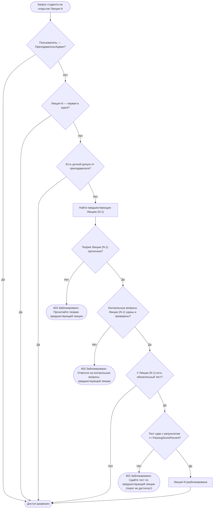

# Детальный план разработки и внедрения информационного ресурса «Электронный учебный кабинет преподавателя и студента»

Данный документ содержит декомпозицию задач, архитектурные решения и этапы реализации проекта в соответствии с Индивидуальным практическим заданием №3 и стандартами разработки (`GEMINI.md`).

---

## 1. Архитектура и стек технологий

| Компонент | Технология | Назначение |
|---|---|---|
| **Платформа / Язык** | .NET 8 / C# 12 | Серверная бизнес-логика и обработка запросов |
| **Веб-фреймворк** | ASP.NET Core MVC | Серверный рендеринг представлений Razor |
| **База данных** | PostgreSQL 18 | Реляционное хранилище данных (`educabinet_db`) |
| **ORM / Доступ к данным** | Entity Framework Core 8 / Npgsql | Миграции, LINQ-запросы, транзакции |
| **Аутентификация и RBAC** | ASP.NET Core Identity | Хеширование паролей (PBKDF2/Argon2), роли, куки-сессии |
| **Интерфейс** | HTML5, CSS3, JavaScript, Bootstrap 5, Bootstrap Icons | Адаптивный веб-интерфейс, поддержка тем и печати |
| **Тестирование** | xUnit, Moq, FluentAssertions, TestHost | Автоматические юнит- и интеграционные тесты |
| **Скрипты развёртывания** | Windows Batch Script (`run.bat`, 7-bit ASCII) | Автоматический 1-кликовый запуск приложения |

---

## 2. Ролевая модель и матрица доступа (RBAC)

Система поддерживает 3 роли с жестким разграничением на уровне контроллеров и политик авторизации (`[Authorize(Roles = ...)]`):

| Действие / Раздел | Студент (`Student`) | Преподаватель (`Teacher`) | Администратор (`Administrator`) |
|---|:---:|:---:|:---:|
| Просмотр открытых дисциплин и тем | ✅ | ✅ | ✅ |
| Просмотр лекций и скачивание материалов | ✅ (только открытые) | ✅ (все) | ✅ (все) |
| Ответы на контрольные вопросы | ✅ | Режим предпросмотра | Режим предпросмотра |
| Прохождение тестов | ✅ | Режим предпросмотра | Режим предпросмотра |
| Просмотр своего прогресса и оценок | ✅ (только свои) | ✅ | ✅ |
| Управление курсами, темами и лекциями | ❌ (403 Forbidden) | ✅ | ✅ |
| Загрузка файлов лекций (PDF, DOCX) | ❌ (403 Forbidden) | ✅ | ✅ |
| Создание вопросов и тестов | ❌ (403 Forbidden) | ✅ | ✅ |
| Проверка ответов студентов и оценивание | ❌ (403 Forbidden) | ✅ | ✅ |
| Ручная разблокировка лекции студенту | ❌ (403 Forbidden) | ✅ (с аудитом) | ✅ (с аудитом) |
| Сводная ведомость группы и печать | ❌ (403 Forbidden) | ✅ | ✅ |
| Управление пользователями и ролями | ❌ (403 Forbidden) | ❌ (403 Forbidden) | ✅ |
| Управление группами студентов | ❌ (403 Forbidden) | Просмотр | ✅ |
| Системный аудит-лог действий | ❌ (403 Forbidden) | ❌ (403 Forbidden) | ✅ |

---

## 3. Схема базы данных (PostgreSQL)

### 3.1. Сущности пользователей и групп
* **`ApplicationUser` (`Users`)**: `Id`, `UserName`, `Email`, `PasswordHash`, `FullName`, `UserRole`, `CreatedAt`.
* **`StudentGroup`**: `Id`, `Name` (например, "ИС-31"), `CourseNumber`, `CreatedAt`.
* **`GroupMembership`**: `Id`, `StudentId` (FK), `GroupId` (FK), `EnrolledAt`.

### 3.2. Учебный контент
* **`Discipline`**: `Id`, `Title`, `Description`, `TeacherId` (FK), `IsPublished`, `CreatedAt`.
* **`Topic`**: `Id`, `DisciplineId` (FK), `Title`, `OrderIndex`, `Description`.
* **`Lecture`**:
  * `Id`, `TopicId` (FK), `Title`, `Description`, `OrderIndex`.
  * `ContentFilePath`, `ContentFileName`, `ContentType`, `FileSizeBytes`.
  * `RequiresTestToUnlockNext` (bool), `PassingScorePercent` (int, default 70).
  * `RequiresManualQuestionsCheck` (bool).
  * `CreatedAt`, `UpdatedAt`.

### 3.3. Контроль знаний (Вопросы и тесты)
* **`ControlQuestion`**:
  * `Id`, `LectureId` (FK), `QuestionText`, `QuestionType` (`ShortAnswer`, `SingleChoice`, `MultipleChoice`, `Matching`, `DetailedAnswer`).
  * `OptionsJson`, `CorrectAnswer`, `MaxScore`, `OrderIndex`.
* **`StudentAnswer`** *(Разделение по правилу GEMINI.md)*:
  * `Id`, `QuestionId` (FK), `StudentId` (FK).
  * **Данные студента:** `StudentAnswerText`, `SubmittedAt`.
  * **Данные преподавателя:** `TeacherScore`, `TeacherFeedback`, `IsGraded`, `GradedById` (FK), `GradedAt`.
* **`Test`**:
  * `Id`, `LectureId` (FK), `Title`, `PassingScorePercent`, `MaxAttempts`, `TimeLimitMinutes`, `ShuffleQuestions`, `ShuffleOptions`.
* **`TestQuestion`**: `Id`, `TestId` (FK), `QuestionText`, `QuestionType`, `Points`, `OrderIndex`.
* **`AnswerOption`**: `Id`, `QuestionId` (FK), `OptionText`, `IsCorrect`, `OrderIndex`.
* **`TestAttempt`**:
  * `Id`, `TestId` (FK), `StudentId` (FK), `AttemptNumber`.
  * `StartedAt`, `CompletedAt`, `ScorePercent`, `TotalPoints`, `MaxPoints`, `IsPassed`.
* **`StudentTestAnswer`**:
  * `Id`, `AttemptId` (FK), `QuestionId` (FK), `SelectedOptionIdsJson`, `TextAnswer`, `IsCorrect`, `PointsAwarded`.

### 3.4. Прогресс и доступ
* **`LectureProgress`**:
  * `Id`, `StudentId` (FK), `LectureId` (FK).
  * `IsTheoryRead`, `AreQuestionsPassed`, `IsTestPassed`, `IsCompleted`, `CompletedAt`.
  * `IsUnlockedManually`, `UnlockedByTeacherId` (FK), `UnlockReason`, `UnlockedAt`.
* **`AuditLog`**:
  * `Id`, `Action`, `EntityName`, `EntityId`, `UserId` (FK), `IpAddress`, `Details`, `Timestamp`.

---

## 4. Алгоритм последовательного открытия лекций (`LectureAccessService`)

---

## 5. Требования стандарта разработки (`GEMINI.md`)

1. **Разделение пользовательских и служебных данных:**
   - Поля студента (`StudentAnswerText`, `SubmittedAt`) защищены от перезаписи при выставлении оценки преподавателем (`TeacherScore`, `TeacherFeedback`, `GradedAt`).
2. **Печатные формы и отчёты:**
   - Ведомость группы и индивидуальная экзаменационная карточка студента.
   - Экранирование `@@media print` в Razor.
   - Кнопка `window.print()`, класс `.no-print` для навигации, шапки и кнопок.
   - Официальное оформление: наименование учреждения, номер, дата, таблица с баллами, места для подписей экзаменатора и «М.П.».
3. **Скрипт запуска `run.bat`:**
   - Кодировка strictly 7-bit ASCII.
   - Проверка `dotnet` и службы PostgreSQL `postgresql-x64-18`.
   - Запуск браузера с задержкой 3 секунды на `http://localhost:5000`.
   - Запуск `dotnet run`.
4. **Удобство демонстрации:**
   - Кнопки быстрого входа в 1 клик на странице логина:
     - 👨‍🎓 `student@cabinet.local` / `Student123!`
     - 👨‍🏫 `teacher@cabinet.local` / `Teacher123!`
     - 👑 `admin@cabinet.local` / `Admin123!`
   - Предзаполненная демонстрационная дисциплина «Внедрение и поддержка компьютерных систем» с лекциями, вопросами и тестами.
5. **Документация и тесты:**
   - `README.md` с инструкцией запуска в 1 шаг.
   - `PLAN.md` (настоящий документ).
   - Набор автоматических тестов xUnit, покрывающий все 12 проверок из задания.

---

## 6. Декомпозиция этапов реализации

### Этап 1. Инициализация проекта и базы данных
- [x] Создание Git-репозитория и добавление `GEMINI.md` в `.gitignore`.
- [x] Пуш начального коммита на GitHub (`yourprettygood/trpoind3`).
- [x] Создание БД `educabinet_db` в PostgreSQL.
- [ ] Создание решения `EduCabinet.sln`:
  - Проект веб-приложения `src/EduCabinet.Web` (ASP.NET Core MVC).
  - Проект тестов `tests/EduCabinet.Tests` (xUnit).
- [ ] Установка NuGet-пакетов:
  - `Npgsql.EntityFrameworkCore.PostgreSQL`
  - `Microsoft.AspNetCore.Identity.EntityFrameworkCore`
  - `Microsoft.EntityFrameworkCore.Tools`
  - `FluentAssertions`, `Moq`.

### Этап 2. Моделирование данных и миграции
- [ ] Определение сущностей БД согласно спецификации (раздел 3).
- [ ] Настройка `ApplicationDbContext` с Fluent API связями и каскадным удалением.
- [ ] Генерация начальной миграции EF Core и применение к PostgreSQL.
- [ ] Реализация `DbInitializer` / `DatabaseSeeder`:
  - Создание ролей (`Administrator`, `Teacher`, `Student`).
  - Создание тестовых пользователей с хэшированными паролями.
  - Наполнение дисциплины «Внедрение и поддержка компьютерных систем» (3 темы, лекции, тесты).

### Этап 3. Ядро последовательного доступа (`LectureAccessService`)
- [ ] Разработка интерфейса `ILectureAccessService` и реализации.
- [ ] Реализация методов:
  - `CanAccessLectureAsync(string studentId, int lectureId)`
  - `GetStudentLectureStatusAsync(string studentId, int lectureId)`
  - `UnlockLectureManuallyAsync(string studentId, int lectureId, string teacherId, string reason)`
- [ ] Серверная защита в контроллере лекций (возврат `403 Forbidden` с описанием причины).

### Этап 4. Интерфейс и контроллеры студента
- [ ] Личный кабинет студента: список курсов, прогресс-бары освоения, темы и лекции со статусами (открыта, заблокирована, пройдена).
- [ ] Страница чтения лекции: отображение текста, скачивание / просмотр прикрепленных PDF/DOCX.
- [ ] Блок контрольных вопросов с отправкой ответов.
- [ ] Страница прохождения теста: интерактивный интерфейс ответов, таймер, результат в процентах.
- [ ] Страница «Моя зачётная книжка / Ведомость» с кнопкой печати (`window.print()`, `@@media print`, `.no-print`, М.П.).

### Этап 5. Интерфейс и контроллеры преподавателя
- [ ] Управление курсами: создание/редактирование дисциплин, тем, лекций.
- [ ] Загрузка файлов лекций в `wwwroot/uploads` с защитой по типам (`.pdf`, `.docx`).
- [ ] Конструктор тестов и контрольных вопросов.
- [ ] Журнал проверки открытых вопросов студентов (выставление баллов и рецензии).
- [ ] Сводная ведомость группы по дисциплине: успеваемость студентов, количество попыток, кнопка ручной разблокировки лекции.
- [ ] Официальная печатная ведомость группы с реквизитами, подписями и печатью.

### Этап 6. Панель администратора и системный аудит
- [ ] Реестр пользователей: смена ролей, привязка к группам.
- [ ] Управление учебными группами.
- [ ] Журнал аудита действий (ручные разблокировки, смена прав).
- [ ] Сводный дашборд статистики.

### Этап 7. Скрипты запуска, автоматические тесты и документация
- [ ] Создание скрипта `run.bat` в строгом 7-битном ASCII.
- [ ] Написание xUnit тестов, проверяющих 12 контрольных пунктов из задания.
- [ ] Создание и оформление `README.md`.
- [ ] Фиксация изменений в Git и отправка на GitHub.
